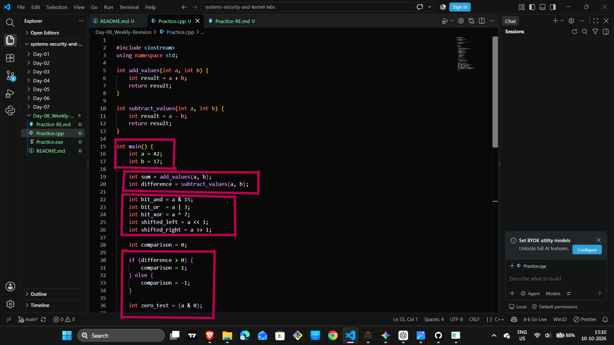
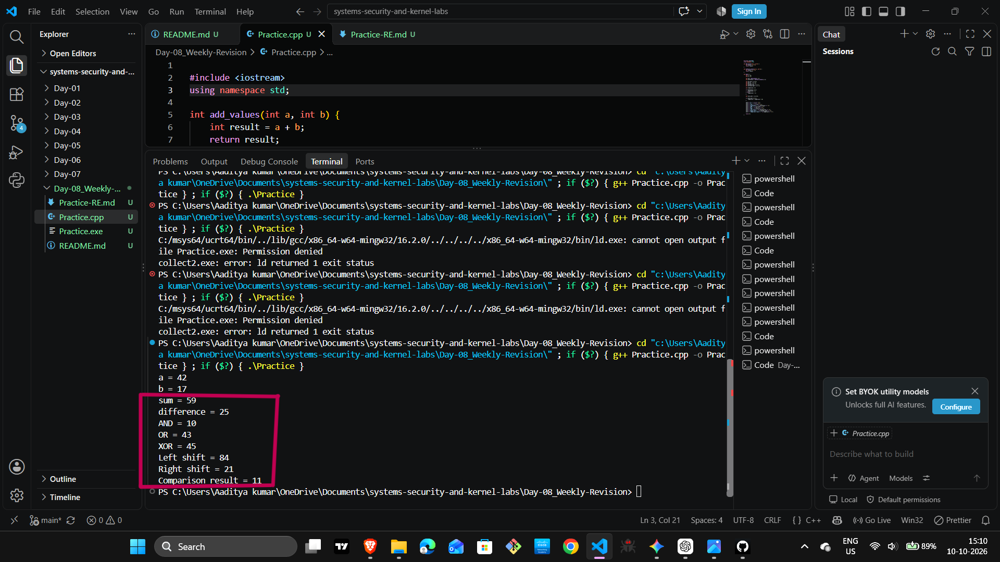
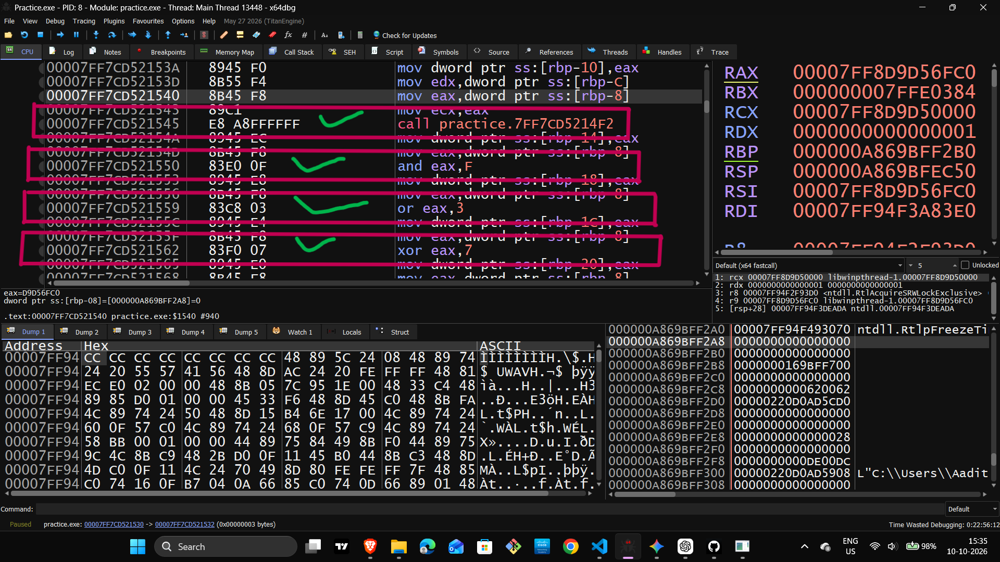
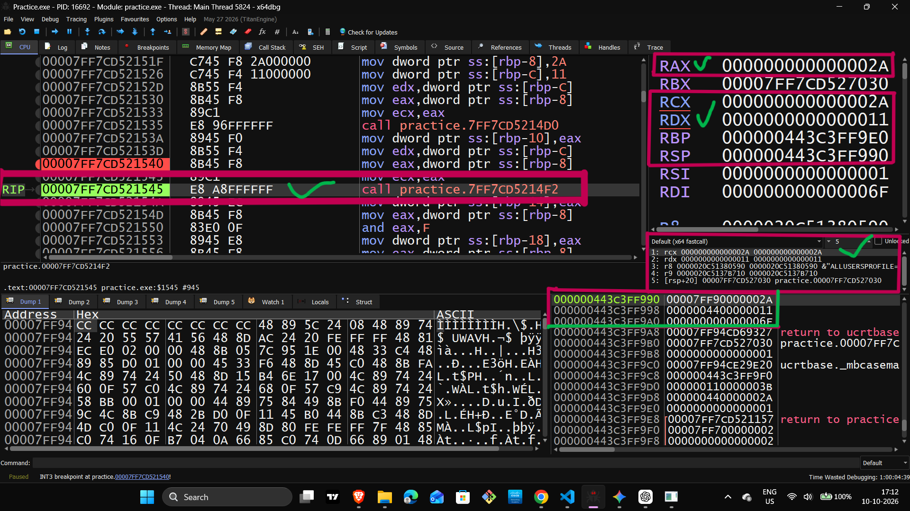
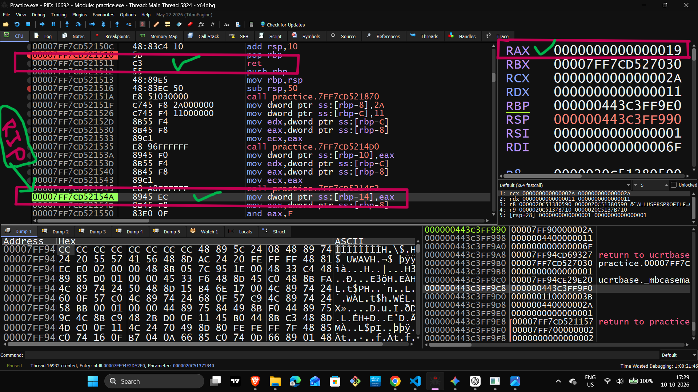

# Day 08 — Weekly Revision: C++, x64 Assembly & Debugging

## Overview

Today, I revised C++ fundamentals and explored how compiled programs execute at the assembly level using x64dbg.

The main focus was understanding CPU registers, stack memory, function calls, arithmetic operations, bitwise instructions, conditional branching, and C++ output operations.

## 1. C++ Source Code

The revision program uses two integer variables:

- `a = 42`
- `b = 17`

The program performs arithmetic, bitwise, shift, and comparison operations.



## 2. Program Output

Expected output:

```text
a = 42
b = 17
sum = 59
difference = 25
AND = 10
OR = 43
XOR = 45
Left shift = 84
Right shift = 21
Comparison result = 11
```



## 3. Main Function Disassembly

I inspected the compiled program in x64dbg to understand how C++ statements translate into assembly instructions.

Key concepts:
- Reading assembly instructions
- Identifying function calls
- Following instruction addresses
- Understanding the execution flow



## 4. Registers and Stack Memory

I explored CPU registers and stack memory during program execution.

Registers studied:
- RAX and EAX
- RCX and ECX
- RDX and EDX
- RBP and RSP

I observed how values are loaded from memory into registers and how register values change during execution.

Example:

```asm
mov eax, dword ptr ss:[rbp-8]
```

This instruction reads four bytes from the specified stack-memory location into EAX.



## 5. Function Calls and Return

I examined the function-call process and the role of CALL and RET.

Key concepts:
- CALL transfers execution to a function or call target.
- RET returns execution to the saved return address.
- Function prologues and epilogues manage stack-frame state.
- RAX is commonly used for integer return values.



## 6. Instruction-Level Debugging

I stepped through instructions using F8 in x64dbg and observed register values before and after execution.

### MOV

```asm
mov rcx, rax
```

Copies the value from RAX into RCX.

### LEA

```asm
lea rdx, qword ptr ds:[...]
```

Calculates an effective address. In the observed output sequence, LEA was used to prepare the address of a string such as `"a = "` or `"b = "`.

### CALL

```asm
call <JMP.&std::ostream::operator<<(int)>
```

Transfers execution to the integer output operation's call target.

These instructions helped me connect assembly execution with the program's C++ output operations.

**Screenshot:** Add a real screenshot showing the relevant MOV, LEA, or CALL instruction here if available.

## 7. Bitwise and Arithmetic Operations

I revised the following operations using `a = 42`.

### AND

```asm
and eax, F
```

Expected result: 42 AND 15 = 10.

### OR

```asm
or eax, 3
```

Expected result: 42 OR 3 = 43.

### XOR

```asm
xor eax, 7
```

Expected result: 42 XOR 7 = 45.

### Addition

```asm
add eax, eax
```

When EAX contains 42, the result is 84.

### Arithmetic Right Shift

```asm
sar eax, 1
```

For the positive value 42, the result is 21.

**Screenshot:** Add a real screenshot showing one or more of these instructions and their register values if available.

## 8. Conditional Branching

I examined comparisons and conditional jumps.

### CMP and JLE

```asm
cmp dword ptr ss:[rbp-14], 0
jle target
```

The comparison checks the value against zero. In the observed execution, the value was positive, so the signed less-than-or-equal condition was false.

### JMP

```asm
jmp target
```

Transfers execution to the target without checking a condition.

### JNE

```asm
jne target
```

Jumps when the compared values are not equal.

In the observed execution, a zero value was compared with zero, so JNE was not taken.

The program then added hexadecimal A (decimal 10) to an existing value of 1, producing 11.

**Screenshot:** Add a real screenshot of the CMP/JLE/JMP/JNE sequence here if available.

## 9. Number Systems

x64dbg commonly displays register values in hexadecimal.

| Decimal | Hexadecimal |
|---:|---:|
| 10 | A |
| 11 | B |
| 17 | 11 |
| 25 | 19 |
| 42 | 2A |
| 43 | 2B |
| 45 | 2D |
| 84 | 54 |

For example:

`2A` hexadecimal = `(2 × 16) + 10` = 42 decimal.

Understanding hexadecimal representation is essential when inspecting registers and memory.

## 10. Current Debugging Checkpoint

The last reported instruction was:

```asm
00007FF708E815F4 | E8 B7010000 |
call <JMP.&std::ostream::operator<<(int)>
```

This call is associated with the integer output operation.

The next step is to continue debugging from this point, inspect the next instruction, and verify the remaining output sequence.

The reported RDX value was `11` hexadecimal. Its role as an argument must be confirmed from the relevant calling convention and the instructions leading up to the call.

## 11. Key Learnings

- Read assembly instructions in execution order.
- Convert hexadecimal register values to decimal when needed.
- Understand the relationship between RAX and EAX.
- Observe how MOV copies values between registers.
- Distinguish an address calculation with LEA from reading or printing data.
- Understand the basic roles of CALL and RET.
- Verify arithmetic and bitwise results.
- Follow conditional branches by examining comparisons and flags.
- Use debugger observations to validate assumptions.

## 12. Next Steps

- Continue the current integer-output debugging session.
- Inspect the remaining output operations.
- Compare debugger observations with the program's expected results.
- Review and organize screenshots.
- Complete the Day 08 practical revision.

## Repository Structure

```text
Day-08_Weekly-Revision/
├── Practice.cpp
├── README.md
└── Screenshots/
    ├── 01_source_code.png
    ├── 02_compile_and_output.png
    ├── 03_main_function_disassembly.png
    ├── 04_registers_and_stack.png
    └── 05_function_return_ret.png
```

Note: Only include screenshots that actually exist in the Screenshots directory.
