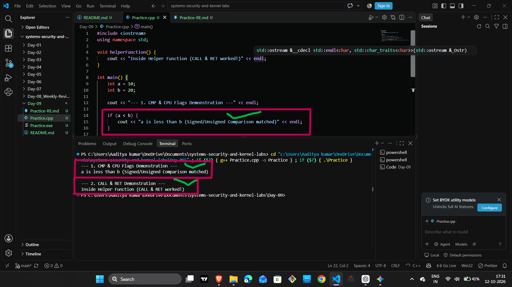
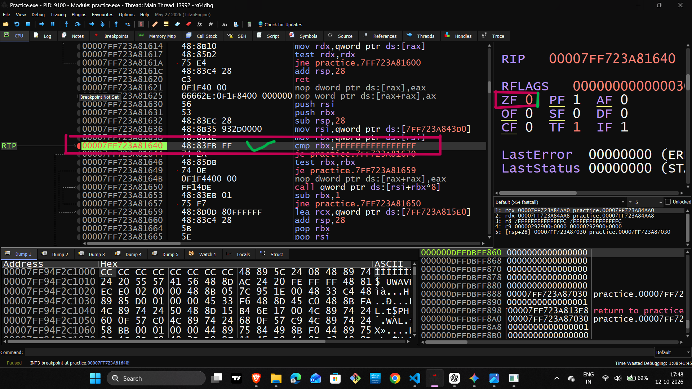

# 🔐 Reverse Engineering & Low-Level Engineering — Day-09

## Weekly Revision: C++ Programming, x64 Assembly & Debugging

Welcome to Day 09 of my **Reverse Engineering & Low-Level Engineering** journey.

Today, I focused on revising previously learned concepts and strengthening my understanding of how high-level C++ code connects to low-level CPU operations.

Rather than focusing only on source code, I reviewed program behavior, assembly instructions, CPU registers, memory, and conditional execution through practical debugging.

## 🎯 Objectives

- Strengthen my understanding of C++ arithmetic and bitwise operations.
- Understand how compilers translate source code into machine-level instructions.
- Review assembly instructions and CPU registers.
- Understand the relationship between `CMP`, CPU flags, and conditional jumps.
- Practice observing program execution with x64dbg.
- Improve my ability to analyze program behavior instead of relying only on source code.

## 🧠 1. Connecting C++ with Machine-Level Execution

C++ is a high-level programming language. It allows developers to express operations using readable statements, while the compiler translates the program into instructions that the processor can execute.

For example, an arithmetic expression in C++ may result in assembly instructions that load values into registers and perform an addition.

The exact instructions depend on the compiler, optimization settings, and program context.

**Key takeaway:** Understanding source code tells us what the program is intended to do. Debugging helps us investigate how the compiled program actually executes.

## ⚙️ 2. Assembly Instructions Reviewed

| Instruction | Purpose |
|---|---|
| `MOV` | Transfers data between registers or memory and registers. |
| `ADD` | Adds two operands. |
| `SUB` | Subtracts one operand from another. |
| `CMP` | Compares operands by updating CPU flags. |
| `TEST` | Performs a bitwise AND for flag-setting purposes without storing the result. |
| `JMP` | Transfers execution to another address. |
| `JE` | Jumps when the Zero Flag is set. |
| `JNE` | Jumps when the Zero Flag is not set. |
| `CALL` | Calls a procedure or function. |
| `RET` | Returns from a procedure or function. |

These instructions help explain how a program performs calculations, evaluates conditions, and changes its execution path.

## 🖥️ 3. CPU Registers and Execution

Registers are small storage locations inside the CPU that are used during instruction execution.

| Register | Common Purpose |
|---|---|
| `RAX` | General-purpose register, commonly used for arithmetic and return values. |
| `RBX` | General-purpose register. |
| `RCX` | General-purpose register; also used for the first integer or pointer argument in the Windows x64 calling convention. |
| `RSP` | Points to the current top of the stack. |
| `RBP` | Often used as a stack-frame reference, depending on the compiler and optimization settings. |
| `RIP` | Identifies the next instruction to execute. |

While debugging, inspecting registers helps reveal how values change as instructions execute.

## 🚩 4. CMP, CPU Flags and Conditional Jumps

The `CMP` instruction compares two operands and updates CPU flags based on the subtraction used internally for comparison.

Consider the following assembly example:

```asm
mov eax, 10
cmp eax, 10
je equal_label
```

### Execution Breakdown

1. `MOV` places the value `10` into `EAX`.
2. `CMP` compares `EAX` with `10`.
3. Because the values are equal, the Zero Flag (`ZF`) becomes `1`.
4. `JE` checks the Zero Flag.
5. The jump is taken because `ZF = 1`.

### Important CPU Flags

| Flag | Meaning |
|---|---|
| `ZF` | Zero Flag |
| `CF` | Carry Flag |
| `SF` | Sign Flag |
| `OF` | Overflow Flag |

**Important distinction:** `CMP` updates flags, while `JE` and `JNE` use those flags to determine whether a jump should occur.

Understanding this relationship is essential for analyzing conditional branches in compiled programs.

## 🔍 5. Practical Debugging with x64dbg

x64dbg helps us inspect the behavior of compiled Windows applications.

During practical debugging, important areas to examine include:

- **Disassembly:** View the assembly instructions.
- **Registers:** Inspect CPU register values.
- **Flags:** Observe the status of CPU flags after relevant instructions.
- **Stack:** Investigate function-call data and stack memory.
- **Execution control:** Step through instructions and observe changes in program state.

### My Debugging Focus

My focus was to connect individual assembly instructions with their effects on program execution.

For example, after stepping over a comparison instruction, I can inspect the relevant flags and then examine whether a conditional jump is taken.

This makes it easier to understand the relationship between instructions, processor state, and control flow.

## 📸 6. Practical Evidence

### Screenshot 1 — C++ Code and Execution

**File:** `01_Code_and_Execution.png`

This screenshot documents the existing C++ practical and its terminal output.



### Screenshot 2 — CMP and CPU Flags

**File:** `02_CMP_and_Flags_Debug.png`

This screenshot documents the debugging session, highlighting the comparison instruction and relevant CPU flags.



*Note: These images should be committed to the repository at the exact paths shown above.*

## 📚 7. Key Takeaways

After this revision, I reinforced the following concepts:

- The relationship between C++ source code and compiled instructions.
- The role of assembly instructions in arithmetic and control flow.
- The purpose of CPU registers during execution.
- How `CMP` updates CPU flags.
- How conditional jumps depend on CPU flags.
- How x64dbg helps inspect instructions and program state.
- Why practical debugging is important for understanding low-level behavior.

## 🚀 8. What's Next?

My next steps in this learning journey are to continue strengthening my assembly and debugging fundamentals, improve my understanding of control flow and memory, and gradually move toward deeper reverse-engineering exercises.

The goal is to build a strong foundation before progressing to more advanced binary analysis and systems-level concepts.

## 🏁 Conclusion

Day 09 was focused on revision, observation, and strengthening my understanding of low-level program execution.

I am continuing this journey one practical exercise at a time, with an emphasis on understanding how programs work internally rather than simply memorizing instructions.

**Learn. Debug. Analyze. Improve.**

---

**Track:** Reverse Engineering & Low-Level Engineering  
**Day:** 09  
**Focus:** C++ · x64 Assembly · CPU Registers · Flags · x64dbg

#ReverseEngineering #AssemblyLanguage #Cpp #x64dbg #LowLevelEngineering #SystemsProgramming
