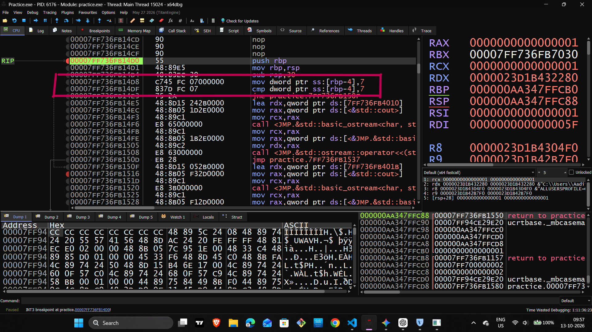
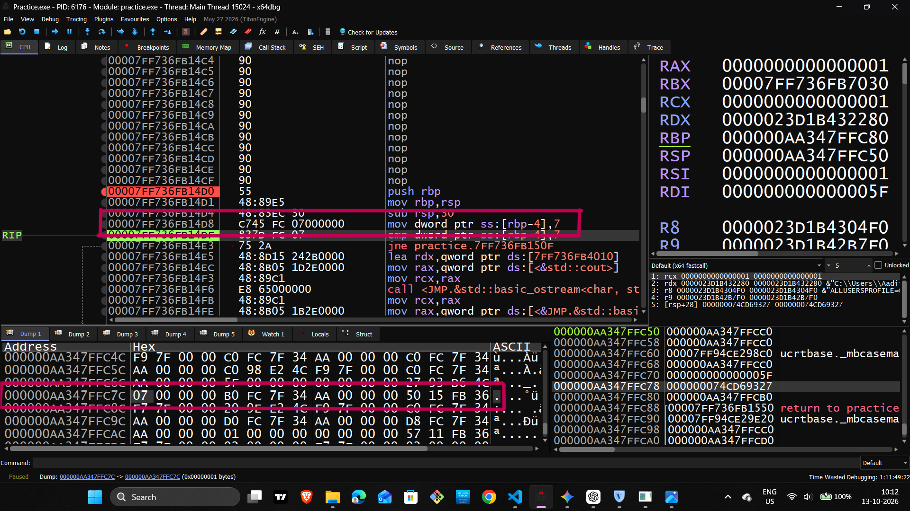
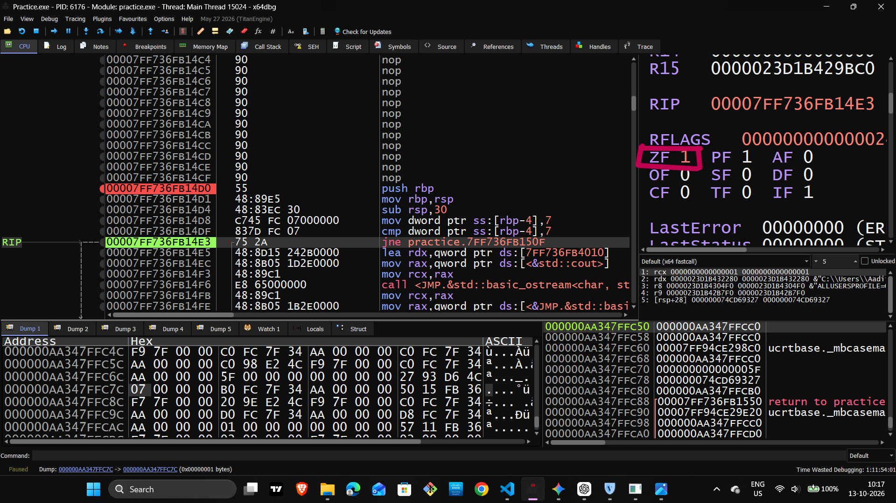
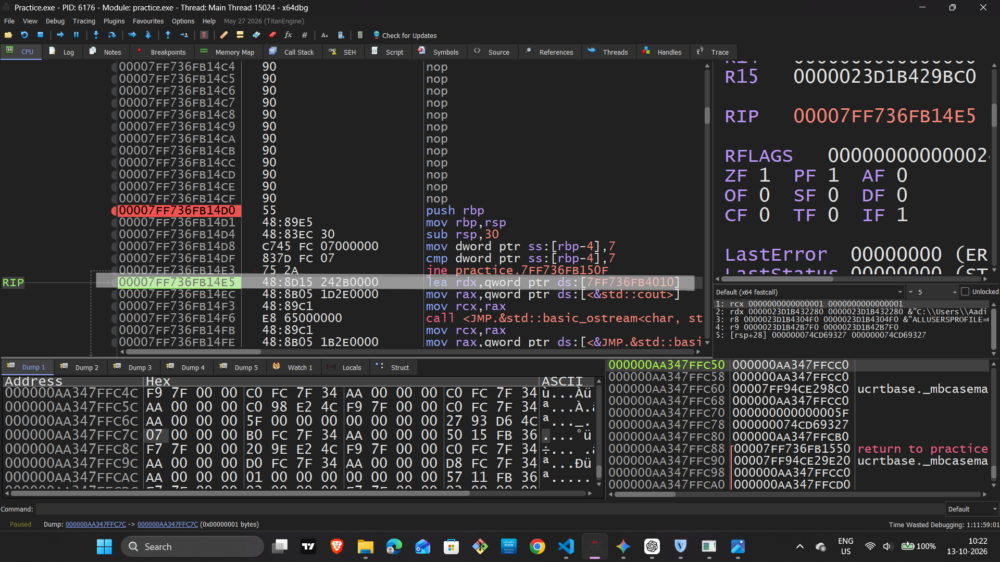

# Reverse Engineering & Low-Level Engineering — Day 10

## x64dbg Practical: Stack Frames, Local Variables, and CPU Flags

## Overview

In this practical session, I explored how a compiled C++ program uses the stack, stores local variables in memory, and makes decisions using CPU status flags.

Using **x64dbg**, I followed the assembly instructions step by step and observed how the CPU's registers, memory, and program flow changed during execution.

### Learning Objectives

- Understand how a function creates a stack frame.
- Learn how `RBP` and `RSP` are used during function execution.
- Inspect a local variable directly in memory.
- Understand how `CMP` updates the Zero Flag (ZF).
- Observe how `JNE` controls conditional program flow.
- Connect assembly instructions with the behavior of a compiled C++ program.

---

## Step 1: Opening the Executable in x64dbg

### What I Did

I opened my compiled C++ executable (`.exe`) in x64dbg and navigated to the Disassembly window to locate the target function, `myTestFunction`.

I inspected the instructions responsible for setting up the function's stack frame.

### Assembly Instructions

```asm
push rbp
mov rbp, rsp
sub rsp, 30h
```

### Explanation

- **`push rbp`** — Saves the previous value of `RBP` on the stack.
- **`mov rbp, rsp`** — Establishes the base of the current stack frame.
- **`sub rsp, 30h`** — Reserves 48 bytes of stack space for local data and other stack needs.

Here, `30h` is a hexadecimal value equal to 48 in decimal.

These instructions form a common function prologue, although compiler-generated code may differ.

### Screenshot 1: Main Disassembly Window

* 📸 **Where to attach the screenshot:** 

Capture the x64dbg window showing the loaded executable and the relevant assembly instructions.

---

## Step 2: Creating the Stack Frame and Storing a Local Variable

### What I Did

I used **F7 (Step Into)** to execute the instructions one at a time and observe the stack-frame setup.

After the stack frame was established, I inspected the instruction that stores the value `7` in memory.

### Assembly Instruction

```asm
mov dword ptr ss:[rbp-4], 7
```

### Explanation

- `mov` stores a value in the specified destination.
- `dword ptr` specifies a 32-bit memory value (4 bytes).
- `[rbp-4]` refers to a memory address four bytes below the address held in `RBP`.
- `7` is the value being stored.

This instruction writes the integer `7` into a four-byte memory location.

### Memory Verification

In x64dbg, I inspected the relevant address in the Dump window.

The expected bytes were:

```text
07 00 00 00
```

These bytes represent the 32-bit integer `7` in little-endian format.

**Important:** `[RBP-4]` is a memory reference, not a register. Its meaning depends on the current value of `RBP`.

### Screenshot 2: Stack and Memory Dump

* 📸 **Where to attach the screenshot:** 

Capture the instruction and the corresponding Dump window showing the bytes `07 00 00 00`. Make sure the memory address can be related to `[RBP-4]`.

---

## Step 3: Comparing the Value and Checking the Zero Flag

### What I Did

I executed the comparison instruction using F7 and examined the CPU flags in the Registers window.

### Assembly Instruction

```asm
cmp dword ptr ss:[rbp-4], 7
```

### Explanation

The `CMP` instruction compares the value stored at `[RBP-4]` with `7`.

It performs a subtraction for flag-setting purposes but does not save the subtraction result to the destination operand.

In this practical:

- Value in memory: `7`
- Comparison value: `7`
- Comparison result: Equal
- Zero Flag (`ZF`): `1`

Because both values are equal, the comparison produces a zero result for flag-setting purposes, so `ZF` becomes `1`.

### Understanding ZF

| Zero Flag | Meaning |
|---|---|
| `ZF = 1` | The comparison found equal values. |
| `ZF = 0` | The comparison found unequal values. |

These meanings apply to the result of the relevant comparison or operation.

### Screenshot 3: Zero Flag Verification

* 📸 **Where to attach the screenshot:** 

Capture the Registers window after executing `CMP`, with `ZF = 1` clearly visible.

---

## Step 4: Understanding JNE and Conditional Program Flow

### What I Did

I examined the conditional jump instruction following the comparison.

### Assembly Instruction

```asm
jne not_equal
```

The actual compiled instruction may use a different label or address, such as `jne practice...`.

### Explanation

`JNE` means **Jump if Not Equal**.

It checks the Zero Flag:

- If `ZF = 0`, the jump is taken.
- If `ZF = 1`, the jump is not taken.

In this practical, the comparison was between `7` and `7`. Therefore, `ZF = 1`, and the `JNE` instruction was not taken.

Execution continued with the next sequential instruction.

If the program subsequently prints `Equal to 7`, that output is consistent with the comparison and conditional branch.

**Key concept:** `CMP` sets the flags, and `JNE` uses those flags to decide whether to change the execution path.

### Screenshot 4: Conditional Jump Behavior

* 📸 **Where to attach the screenshot:** 

Capture the `JNE` instruction and the relevant Disassembly or Registers window. Show that `ZF = 1` and that execution continues along the non-jump path.

---

## Practical Results

During this session, I observed the following:

- The function prologue established a stack frame.
- `RBP` provided a reference point for accessing a local variable.
- The value `7` was stored and inspected in memory.
- The Dump window displayed the value as `07 00 00 00`.
- `CMP` set the Zero Flag based on the comparison.
- `JNE` was not taken because `ZF = 1`.
- Program execution continued along the sequential path.

These observations helped connect assembly instructions with actual register values, memory contents, and control flow.

---

## Key Takeaways

This practical strengthened my understanding of:

- Stack frames and function prologues.
- The roles of `RBP` and `RSP`.
- Local variables and memory addressing.
- Little-endian representation.
- The `CMP` instruction and Zero Flag.
- Conditional branching using `JNE`.
- Step-by-step debugging with x64dbg.

Understanding these fundamentals is an important step toward analyzing compiled programs and developing reverse engineering skills.

---

## Screenshots Directory

Organize the screenshots in the following structure:

```text
Day-10/
├── README.md
└── Screenshots/
    ├── 01_x64dbg_main_screen.png
    ├── 02_stack_and_memory_dump.png
    ├── 03_zero_flag_check.png
    └── 04_jne_skipped.png
```

Make sure the screenshot filenames match the names used in this document.

---

## Day 10 Summary

**Topic:** x86-64 Assembly and Practical Debugging  
**Tool:** x64dbg  
**Focus:** Stack Frames, Local Variables, Memory Inspection, CPU Flags, and Conditional Jumps

Today, I practiced tracing a function's stack-frame setup, inspecting a local variable in memory, and understanding how CPU flags influence conditional execution.

My next step is to continue debugging compiled programs and strengthen my understanding of assembly instructions, registers, and control flow.

#ReverseEngineering #AssemblyLanguage #x64dbg #LowLevelProgramming #ComputerArchitecture #LearningInPublic
