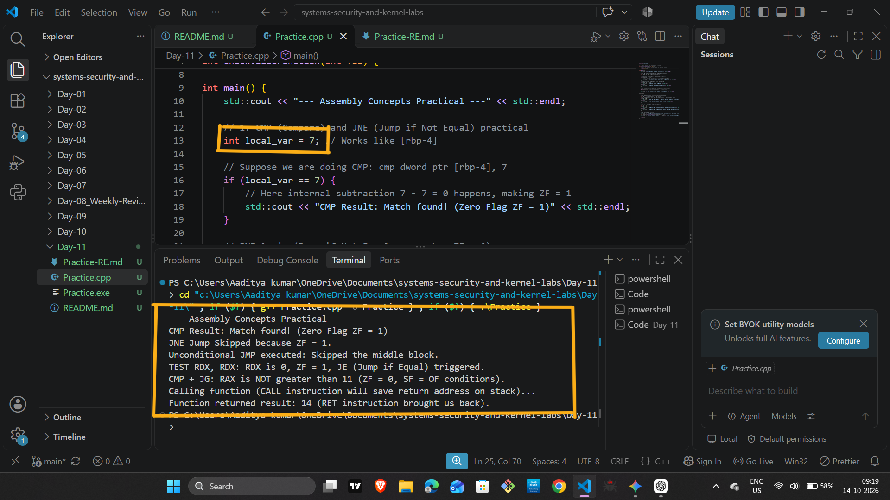
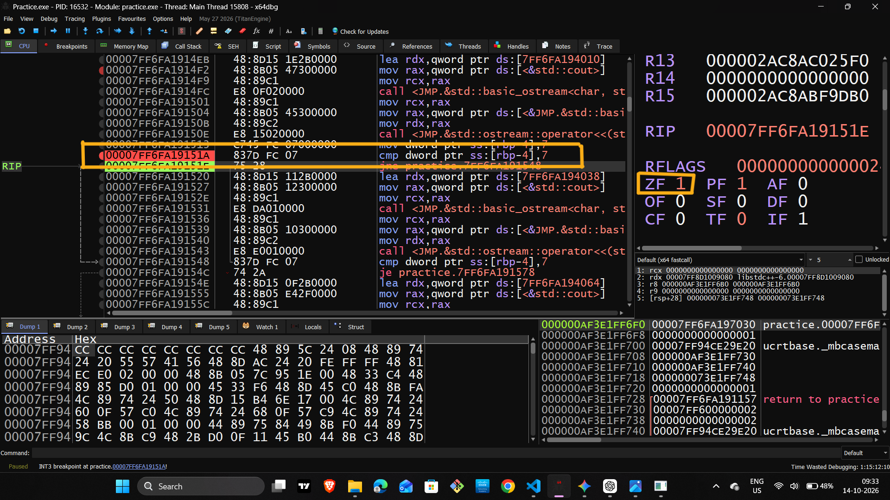
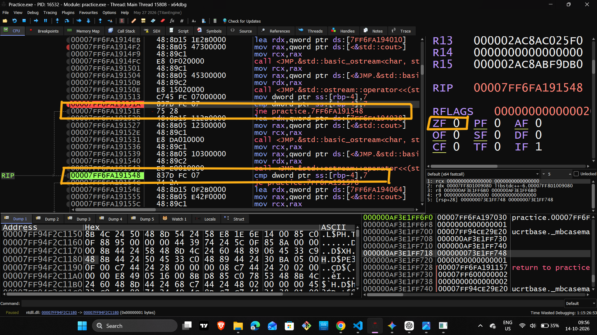
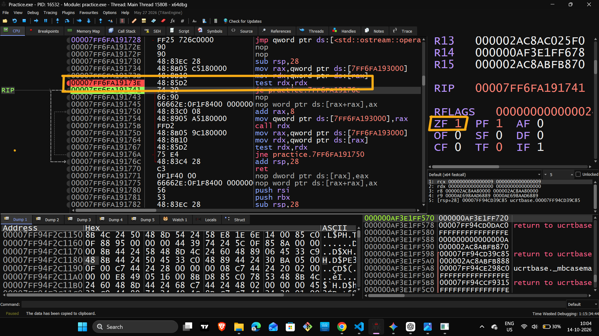
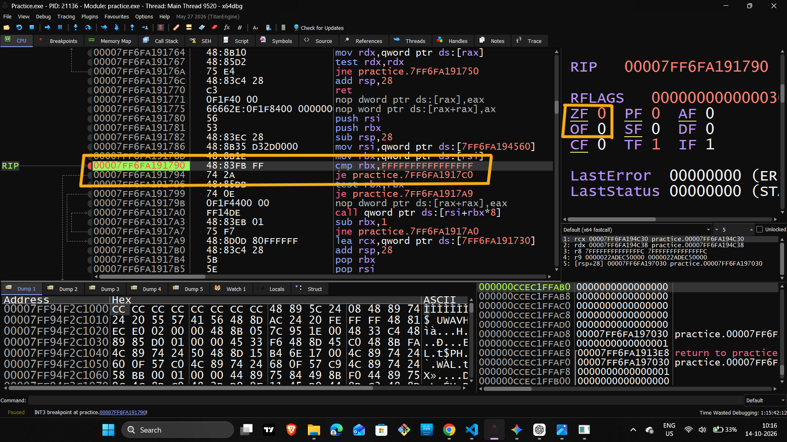
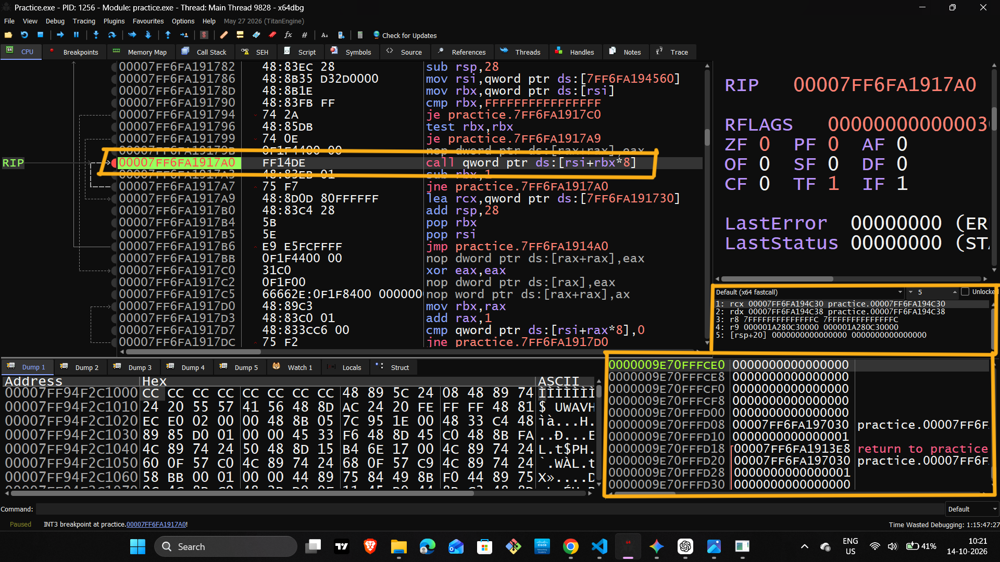
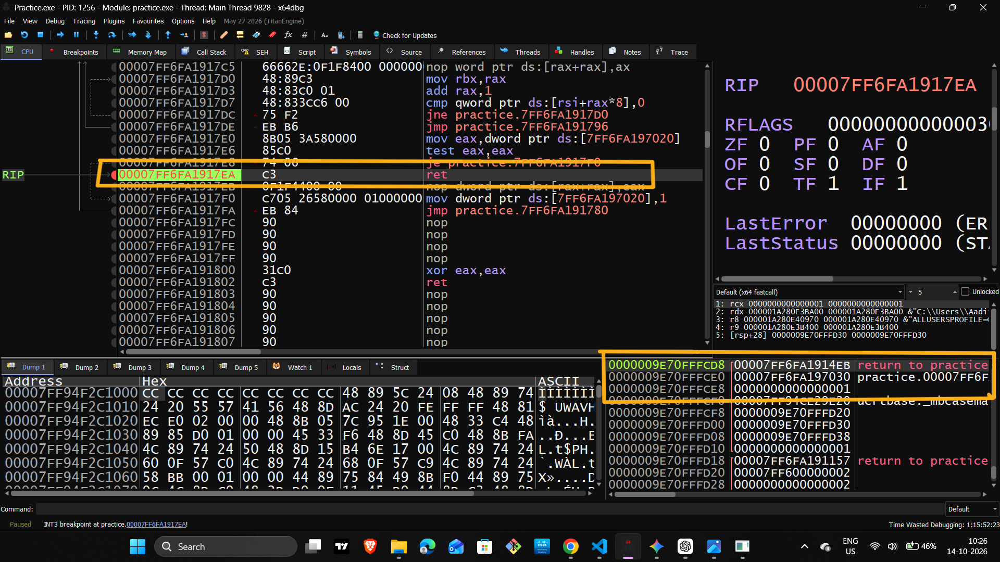

# Reverse Engineering & Low-Level Engineering — Day 11

## x64 Assembly Debugging & Control Flow Analysis

**Focus:** x86-64 Assembly, CPU Flags, Conditional Branching, Stack Operations, and Function Execution

**Debugging Tool:** x64dbg

---

## 1. Learning Objectives

The objective of Day 11 is to understand how a CPU compares values, evaluates conditions, changes execution flow, and transfers control between functions.

By the end of this study session, the following concepts should be clear:

- How the `CMP` instruction updates CPU flags.
- How conditional jumps use flags to make branching decisions.
- How `JMP` changes execution flow without checking a condition.
- How `TEST` checks values and individual bits.
- How signed comparisons use `ZF`, `SF`, and `OF`.
- How `CALL` and `RET` manage function execution.
- How to observe instruction execution, registers, and stack memory in x64dbg.

---

## 2. Understanding the CPU Execution Environment

Before studying individual instructions, it is important to understand three architectural components.

### 2.1 Instruction Pointer — RIP

The `RIP` register identifies the address from which the processor fetches the next instruction in the normal execution sequence.

When a jump, call, or return changes the execution destination, the instruction pointer is updated accordingly.

**Key points:**
- Tracks the current instruction-fetch location.
- Advances as instructions are processed.
- Changes when control-flow instructions redirect execution.
- Helps identify the current execution location during debugging.

### 2.2 Flags Register — RFLAGS

The `RFLAGS` register contains processor status and control flags.

Arithmetic, comparison, and logical instructions update specific flags. Conditional jump instructions evaluate these flags to determine whether a branch should be taken.

| Flag | Meaning |
|---|---|
| `ZF` | Zero Flag — indicates whether the relevant result is zero. |
| `SF` | Sign Flag — reflects the most significant bit of the result. |
| `OF` | Overflow Flag — indicates signed arithmetic overflow. |
| `CF` | Carry Flag — indicates carry or borrow conditions relevant to unsigned arithmetic. |
| `PF` | Parity Flag — reflects the parity of the result's low byte. |

**Important:** Not every instruction modifies every flag. Always identify which flags the current instruction actually changes.

### 2.3 Stack Pointer — RSP

The `RSP` register points to the current top of the stack.

The stack is commonly used to support function calls, return addresses, saved registers, and local data.

**Key points:**
- The x86-64 stack normally grows toward lower memory addresses.
- Pushing data decreases `RSP`.
- Removing data from the stack increases `RSP`.
- Stack layout depends on the function's operations and calling convention.

Function arguments are not necessarily all stored on the stack. Under common x64 calling conventions, some arguments are passed through registers.

---

## 3. Step 1 — Comparison and the Zero Flag (CMP)

The `CMP` instruction compares two operands by performing subtraction for flag calculation.

It does not store the subtraction result in either operand.

### Key Takeaways

- Conceptually calculates the destination operand minus the source operand.
- Updates the relevant status flags.
- Sets `ZF = 1` when the comparison result is zero.
- Sets `ZF = 0` when the comparison result is nonzero.
- Does not modify the original operands.
- Supports both signed and unsigned comparisons through different conditional jump instructions.

The `CMP` instruction does not directly decide whether a branch occurs. It establishes the flag state that a subsequent conditional jump evaluates.

### Screenshot

### 1. C++ Code and Execution Output

- **Red Box 1:** Highlight the `CMP` instruction in the disassembly view.
- **Red Box 2:** Highlight the relevant status flags in the registers or flags panel.

**Screenshot objective:** Show the comparison instruction and the CPU flags associated with its execution.

---

## 4. Step 2 — Conditional Branching (JNE / JNZ)

`JNE` means **Jump if Not Equal**. `JNZ` means **Jump if Not Zero**.

In x86-64, both instructions use the same condition: the Zero Flag must be clear.

### Branch Conditions

- `ZF = 0`: The jump is taken.
- `ZF = 1`: The jump is not taken.

After a `CMP` instruction, this condition commonly represents inequality.

### Key Takeaways

- Conditional jumps evaluate CPU flags.
- `JNE` and `JNZ` are equivalent in their branching condition.
- If the branch is taken, execution transfers to the specified target.
- Otherwise, execution continues with the next sequential instruction.
- The actual outcome depends on the current flag state, not simply on the presence of the jump instruction.

### Screenshot

### 2. CMP Instruction and CPU Flags

- **Red Box 1:** Highlight the `JNE` instruction and its destination.
- **Red Box 2:** Highlight `ZF = 0` in the flags panel.

**Screenshot objective:** Identify the branch condition and the target address.

---

## 5. Step 3 — Unconditional Branching (JMP)

The `JMP` instruction transfers execution to a specified destination without checking a conditional flag.

### Key Takeaways

- Does not require a particular `ZF`, `SF`, `OF`, or `CF` state.
- Changes the normal sequential execution path.
- Can transfer execution forward or backward.
- Is commonly used in loops, control-flow transitions, and compiler-generated branch structures.
- Does not itself modify the arithmetic status flags.

The destination may be represented by a relative displacement or another supported addressing form.

### Screenshot

### 3. JNE and JMP Instructions

- **Red Box 1:** Highlight the `JMP` instruction and its destination address.

**Screenshot objective:** Show how execution transfers directly to another location.

---

## 6. Step 4 — Logical Testing (TEST)

The `TEST` instruction performs a bitwise AND operation for flag calculation without storing the result.

Neither operand is modified.

### Key Takeaways

- Performs a logical AND between its operands.
- Sets `ZF = 1` when the AND result is zero.
- Sets `ZF = 0` when the result is nonzero.
- Clears `CF` and `OF`.
- Updates `SF` and `PF` according to the result.
- Does not store the AND result in a general-purpose register.

`TEST` is frequently used to check whether a register is zero or whether selected bits are present in a value.

When checking a pointer or function return value, a zero result may represent a null pointer or a failure condition. Its actual meaning depends on the program's logic.

### Screenshot

### 4. TEST Instruction

- **Red Box 1:** Highlight the `TEST` instruction.
- **Red Box 2:** Highlight the resulting `ZF` state.

**Screenshot objective:** Show how a logical instruction prepares the CPU flags for conditional branching.

---

## 7. Step 5 — Signed Comparisons (CMP + JG / JL)

Signed comparisons determine the relative ordering of values interpreted as signed integers.

They must account for both the Sign Flag and Overflow Flag rather than relying on the Sign Flag alone.

### Important Flags

**Sign Flag (SF)**

Reflects the most significant bit of the operation's result. It must be interpreted together with other flags when evaluating signed comparisons.

**Overflow Flag (OF)**

Indicates that a signed arithmetic operation produced a result outside the representable range of its operand size.

### Conditional Jump Rules

| Instruction | Condition |
|---|---|
| `JG` — Jump if Greater | `ZF = 0` AND `SF = OF` |
| `JGE` — Jump if Greater or Equal | `SF = OF` |
| `JL` — Jump if Less | `SF != OF` |
| `JLE` — Jump if Less or Equal | `ZF = 1` OR `SF != OF` |
| `JE` — Jump if Equal | `ZF = 1` |

### Signed vs. Unsigned Comparisons

Signed and unsigned comparisons interpret the same underlying bits differently.

- **Signed:** Commonly uses `JG`, `JGE`, `JL`, and `JLE`.
- **Unsigned:** Commonly uses `JA`, `JAE`, `JB`, and `JBE`.

Choosing the correct jump instruction is essential when reconstructing conditions from disassembled machine code.

### Screenshot

### 5. CMP and JG — Signed Comparison

- **Red Box 1:** Highlight `CMP` and the associated conditional jump.
- **Red Box 2:** Highlight `ZF`, `SF`, and `OF` in the flags panel.

**Screenshot objective:** Connect the signed comparison condition with the processor's flag state.

---

## 8. Step 6 — Function Calls (CALL)

The `CALL` instruction transfers execution to a procedure or function while saving a return address.

For a near call in 64-bit mode, the processor performs two fundamental operations.

1. Saves the address of the instruction following the call on the stack.
2. Transfers execution to the call destination by updating the instruction pointer.

### Key Takeaways

- A near call pushes an eight-byte return address onto the stack.
- The stack pointer decreases by eight bytes for this operation.
- Execution continues at the called function's entry point.
- The saved address allows execution to resume after the call returns.
- The called function may perform additional stack operations.
- The `CALL` instruction does not automatically establish all local variables or pass every function argument.

The x64dbg Call Stack view can help identify function relationships and return locations, although accurate interpretation may depend on available debugging information and stack integrity.

### Screenshot

### 6. CALL Instruction

- **Red Box 1:** Highlight the `CALL` instruction and its destination.
- **Red Box 2:** Highlight the return address at the top of the stack.

**Screenshot objective:** Connect the call instruction with the saved return address.

---

## 9. Step 7 — Function Returns (RET)

The `RET` instruction transfers execution back to the return address stored at the top of the stack.

For a near return in 64-bit mode, the processor:

1. Retrieves the return address from the stack.
2. Updates the instruction pointer with that address.
3. Advances the stack pointer by eight bytes to remove the return address.

### Key Takeaways

- The common near-return opcode is `C3`.
- `RET` retrieves its destination from the stack.
- The instruction pointer resumes execution at the saved return location.
- A near return normally removes eight bytes for the return address.
- Some return forms support additional stack adjustment.
- Incorrect stack state or a corrupted return address can cause execution to transfer to an invalid location.

A function's stack frame may contain additional data, so `RET` should not be treated as automatically reversing every operation performed by `CALL`.

### Screenshot

### 7. RET Instruction

- **Red Box 1:** Highlight the `RET` instruction and its opcode.
- **Red Box 2:** Highlight the return address at the top of the stack.

**Screenshot objective:** Show how the saved return address determines where execution resumes.

---

## 10. Machine-Code Opcode Reference

An opcode identifies the operation encoded in machine code. The complete instruction may also contain operand information, prefixes, addressing fields, or displacement values.

| Instruction Form | Common Encoding |
|---|---|
| Near `RET` | `C3` |
| Near relative `CALL` | `E8` |
| Near relative `JMP` | `E9` |
| Short `JE` | `74` |
| Short `JNE` | `75` |

### Encoding Notes

- The encodings listed above are common forms, not exhaustive lists.
- Short conditional jumps use an eight-bit signed relative displacement.
- Near relative calls and jumps use a displacement whose encoded size depends on the instruction form.
- `CMP` and `TEST` have multiple encodings.
- An opcode byte alone may not represent the complete instruction.
- Correct disassembly requires decoding the entire instruction, including its operands and addressing information.

Understanding these details helps connect raw machine-code bytes with the instructions displayed in a disassembler.

---

## 11. x64dbg Debugging Workflow

x64dbg provides an interactive environment for observing instruction execution, register states, flags, and memory.

### Common Controls

| Action | Shortcut | Purpose |
|---|---|---|
| Toggle Breakpoint | `F2` | Enable or disable a breakpoint at the selected instruction. |
| Run | `F9` | Continue execution until a breakpoint or another stopping condition. |
| Step Into | `F7` | Execute an instruction and enter a called function when applicable. |
| Step Over | `F8` | Execute an instruction while stepping over a function call when applicable. |

### Recommended Observation Points

During debugging, pay attention to:

- The current instruction and address in the disassembly view.
- The `RIP` register and changes in execution location.
- The relevant `RFLAGS` conditions before and after instructions.
- The `RSP` register and stack memory.
- The destination of conditional and unconditional jumps.
- The return address associated with function calls.
- The relationship between instructions and the program's control-flow structure.

**Important:** A breakpoint only stops execution when the program reaches its location. A conditional branch may skip that address entirely.

---

## 12. Common Technical Mistakes to Avoid

- Assuming `CMP` stores its subtraction result in a register.
- Assuming every conditional jump depends only on `ZF`.
- Confusing signed and unsigned comparison instructions.
- Assuming `TEST` stores the result of its logical AND operation.
- Assuming `JMP` changes the arithmetic status flags.
- Assuming `CALL` creates a complete function stack frame automatically.
- Assuming every `RET` uses the same opcode or behavior.
- Treating a single opcode byte as the complete encoding of every instruction.
- Assuming all function arguments are passed on the stack.
- Interpreting register or flag values without checking which instruction last modified them.

---

## 13. Final Summary

Day 11 covered the core mechanisms used by x86-64 processors to compare values, evaluate conditions, redirect execution, and manage function returns.

The key concepts are:

- `CMP` establishes comparison flags.
- `JNE` and `JE` evaluate the Zero Flag.
- `JMP` redirects execution unconditionally.
- `TEST` performs logical flag testing without storing a result.
- Signed conditional jumps interpret `ZF`, `SF`, and `OF` together.
- `CALL` saves a return address and transfers control.
- `RET` retrieves the return address and resumes execution.
- x64dbg helps reveal how these operations affect registers, flags, memory, and execution flow.

These fundamentals form an essential foundation for disassembly analysis, binary inspection, and reverse engineering.

---

**Learning Track:** Reverse Engineering & Low-Level Engineering  
**Day:** 11  
**Architecture:** x86-64  
**Tool:** x64dbg  
**Topics:** Assembly Instructions, CPU Flags, Control Flow, Stack Operations, Function Execution, and Machine-Code Encoding
