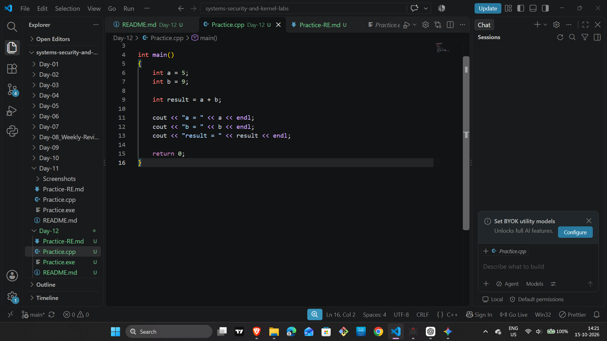
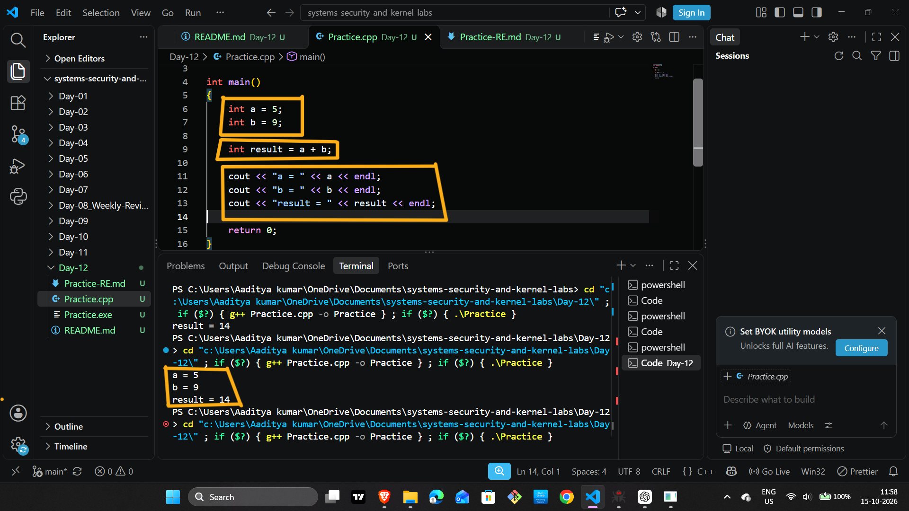
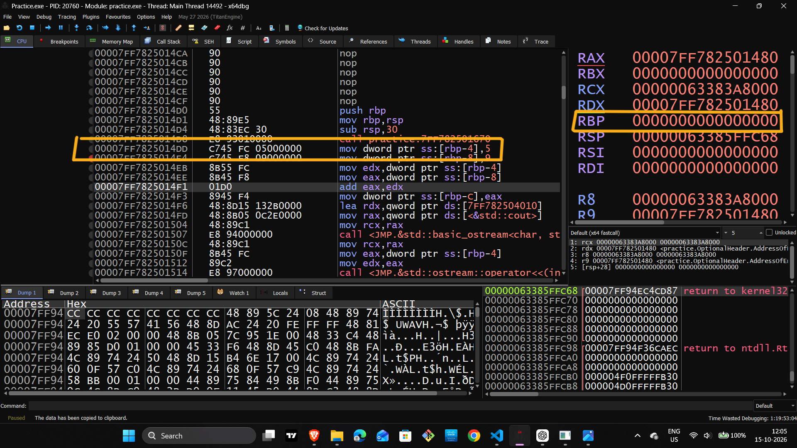
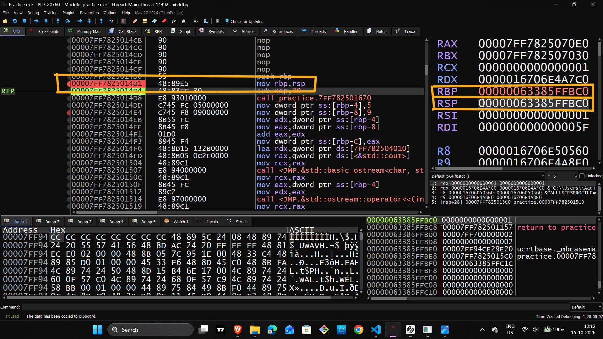
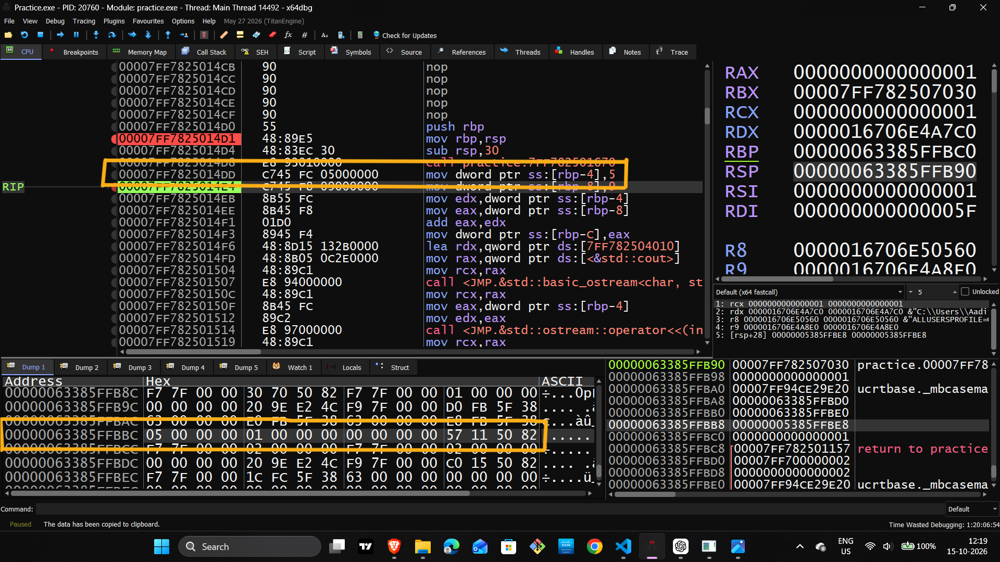
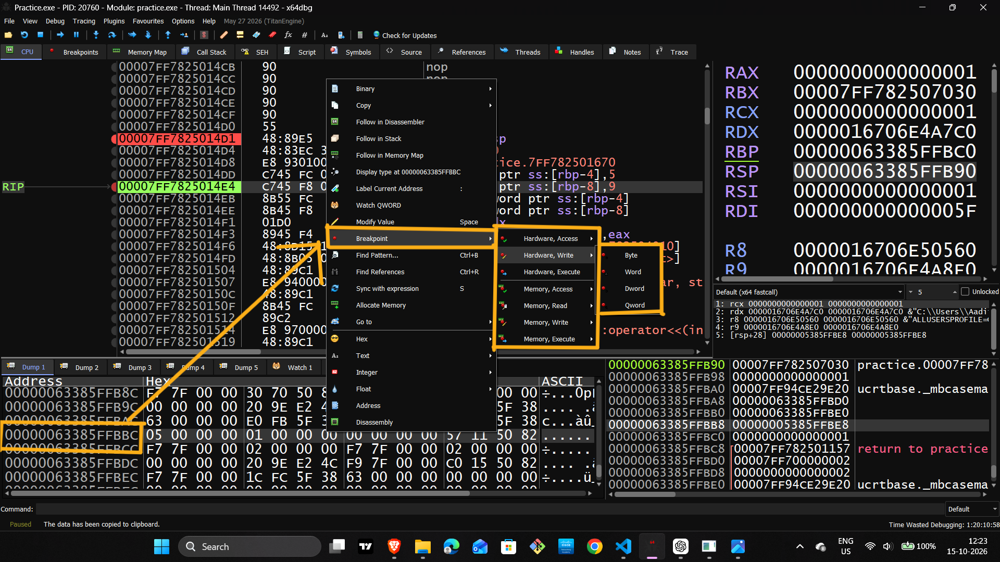
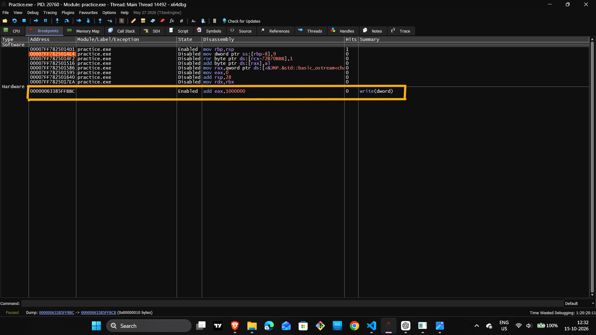
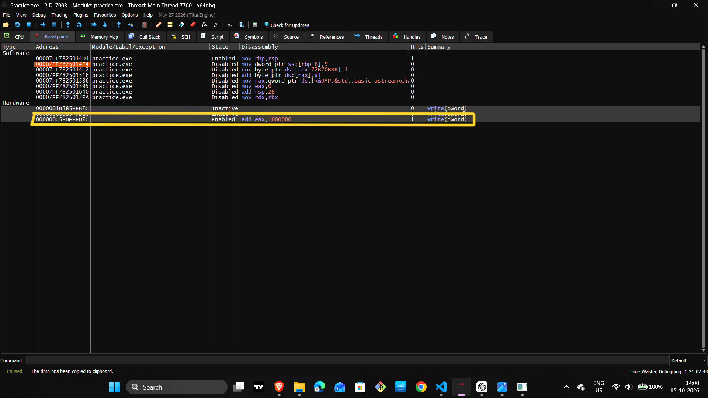
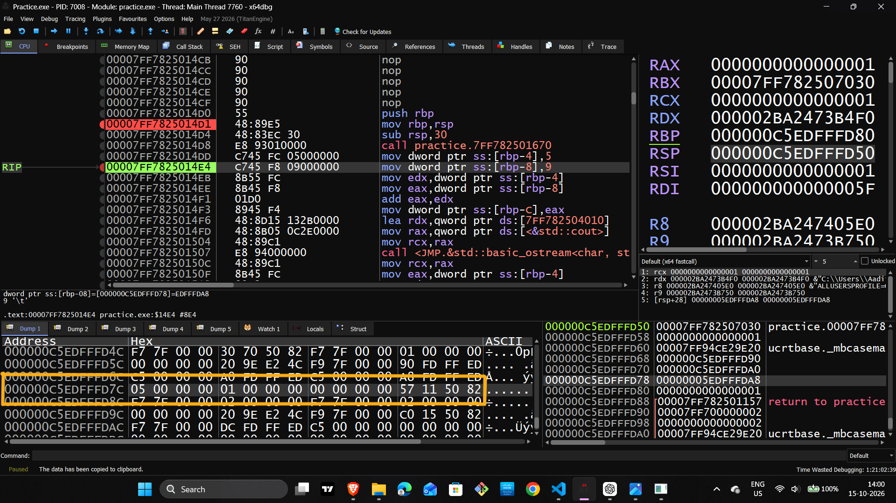

# Day 12 — Software vs Hardware Breakpoints

## Overview

This lab explores software and hardware breakpoints using x64dbg and a small C++ program. The practical focuses on stack memory, variable addresses, hardware write breakpoints, and observing a breakpoint hit during debugging.

## Learning Objectives

- Understand the difference between software and hardware breakpoints.
- Identify local variables stored relative to RBP.
- Navigate CPU and Dump views in x64dbg.
- Configure a hardware write breakpoint for a four-byte value.
- Verify a breakpoint hit using the hit counter and memory contents.

## Lab Environment

- Language: C++
- Debugger: x64dbg
- Target: practice.exe
- Architecture: x64
- Breakpoint type: Hardware
- Access type: Write
- Data size: Dword (4 bytes)

## 1. Test Program

The program initializes two integer variables, calculates their sum, prints the values, and returns.

```cpp
#include <iostream>
using namespace std;

int main()
{
    int a = 5;
    int b = 9;
    int result = a + b;

    cout << "a = " << a << endl;
    cout << "b = " << b << endl;
    cout << "result = " << result << endl;

    return 0;
}
```

Expected output:

```text
a = 5
b = 9
result = 14
```

**Screenshot 01 — Source Code**



Place it here to document the C++ test program.

**Screenshot 02 — Execution Output**



Place it here to show the program output.

## 2. Debugger Setup and Stack Frame

The program was opened in x64dbg. The CPU view was used to inspect the instructions and follow execution.

Relevant instructions observed:

```asm
mov rbp, rsp
sub rsp, 30
call practice.7FF782501670
mov dword ptr ss:[rbp-4], 5
mov dword ptr ss:[rbp-8], 9
```

The `mov rbp, rsp` instruction establishes the frame pointer in this function's stack frame. The `sub rsp, 30` instruction reserves stack space. The local variables are accessed using offsets from RBP.

In this run, the observed local-variable locations were:

| Variable | Memory expression | Meaning |
|---|---|---|
| `a` | `[RBP-4]` | Integer initialized to 5 |
| `b` | `[RBP-8]` | Integer initialized to 9 |
| `result` | `[RBP-0xC]` | Storage for the sum |

These are observations from this build and execution, not fixed addresses for every run.

**Screenshot 03 — Initial Debugger State**



Place it here to show the program loaded in x64dbg.

**Screenshot 04 — RBP and RSP**



Place it here to document the register values after `mov rbp, rsp`.

## 3. Inspecting the Variable Address

The CPU view showed the instruction:

```asm
mov dword ptr ss:[rbp-4], 5
```

The Dump view was navigated to the expression `rbp-4` to inspect the memory associated with variable `a`.

After the write, the memory bytes were observed as:

```text
05 00 00 00
```

This is the little-endian representation of the 32-bit integer 5.

**Screenshot 05 — Variable a in Memory**



Place it here to show the relevant address and memory bytes.

## 4. Hardware Write Breakpoint

A hardware breakpoint was configured from the Dump view using the Hardware → Write → Dword option.

- **Type:** Hardware
- **Access:** Write
- **Size:** Dword (4 bytes)
- **Target:** The current run's address for variable `a`

The stack address changed between runs. Therefore, a breakpoint address from an earlier run was not reused as though it were permanent. The active breakpoint was set on the current run's address.

**Screenshot 06 — Hardware Breakpoint Menu**



Place it here to show the menu option used to configure the breakpoint.

**Screenshot 07 — Hardware Write Breakpoint Verification**



Place it here to show the configured hardware write breakpoint, if this screenshot was captured.

## 5. Breakpoint Hit and Memory Verification

During the successful test, the Breakpoints view showed the following values:

```text
Address: 000000C5EDFFFD7C
State:   Enabled
Hits:    1
Summary: write(dword)
```

The Dump view at the same address showed:

```text
000000C5EDFFFD7C  05 00 00 00
```

The hit counter of 1 confirmed that the hardware write breakpoint had triggered. The memory bytes matched the expected value for `a = 5`.

**Screenshot 08A — Hardware Breakpoint Hit**



Place it here to show the breakpoint entry with `Hits = 1` and `write(dword)`.

**Screenshot 08B — Memory Value**



Place it here to show the target address and bytes `05 00 00 00`.

## 6. Software vs Hardware Breakpoints

| Feature | Software breakpoint | Hardware breakpoint |
|---|---|---|
| Typical mechanism | Replaces a code byte with `INT 3 (0xCC)` | Uses CPU debug registers |
| Common purpose | Pause at an instruction | Monitor execution or selected memory access |
| Memory target | Usually a code location | An instruction or data address, depending on configuration |
| Practical example | Stop before an instruction executes | Detect a write to a variable's memory |

On x86/x64, hardware breakpoint configuration commonly involves debug registers DR0–DR3 for address slots, DR6 for status, and DR7 for control. Hardware breakpoint slots are limited, so they should be used deliberately.

## 7. Results

- Inspected the program in x64dbg.
- Observed stack-frame setup and local-variable addressing.
- Located variable `a` using `[RBP-4]`.
- Inspected its four-byte memory representation.
- Configured a hardware write breakpoint for the current run's variable address.
- Verified a breakpoint hit with `Hits = 1`.
- Confirmed the stored value as `05 00 00 00`.

## 8. Conclusion

This lab demonstrated how a hardware write breakpoint can be used to monitor a selected memory location while debugging a native x64 program. It also reinforced stack-relative addressing, little-endian integer representation, and the importance of recalculating stack addresses when a program is restarted.

## Repository Structure

```text
Day-12_Software-vs-Hardware-Breakpoints/
├── README.md
└── Screenshots/
    ├── 01_Source_Code.png
    ├── 02_Execution_Output.png
    ├── 03_x64dbg_Initial_State.png
    ├── 04_RBP_RSP_After_Mov.png
    ├── 05_a_Memory_Address.png
    ├── 06_Hardware_Breakpoint_Menu.png
    ├── 07_Hardware_Write_Breakpoint_Verification.png
    ├── 08A_Hardware_Breakpoint_Hit.png
    └── 08B_Memory_Value.png
```

## Scope and Limitations

This was a focused introductory lab using a small C++ program. It demonstrates one successful hardware write-breakpoint test; it is not a comprehensive analysis of every software or hardware breakpoint behavior.