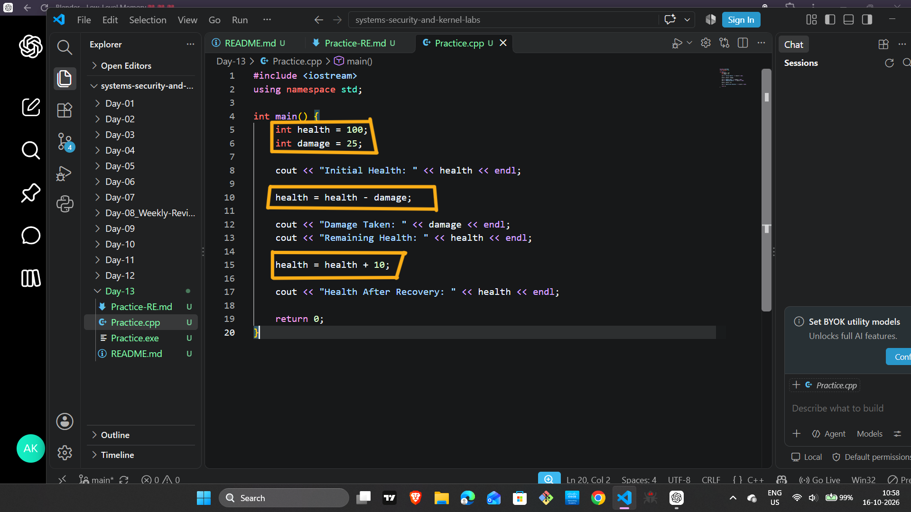
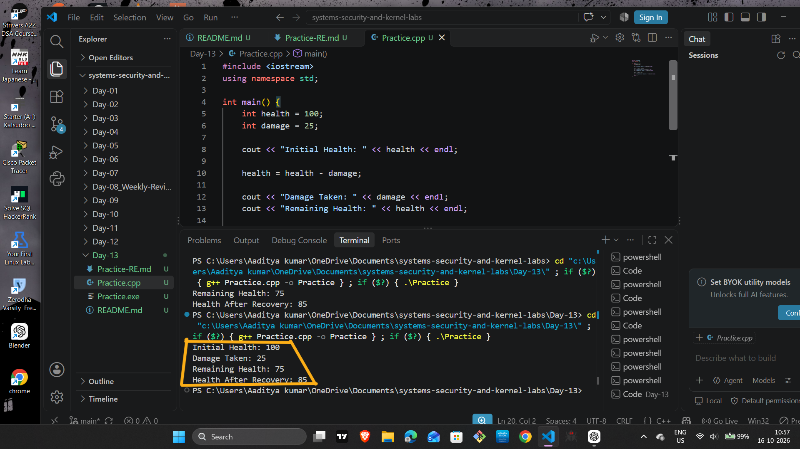
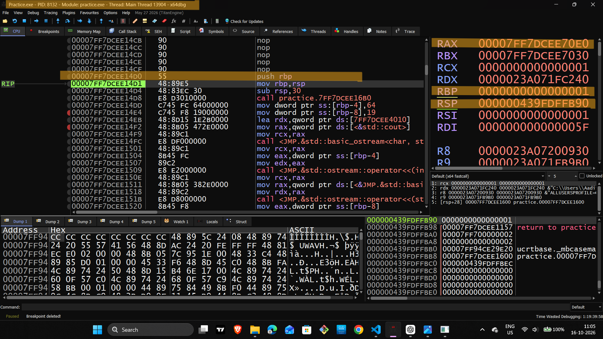
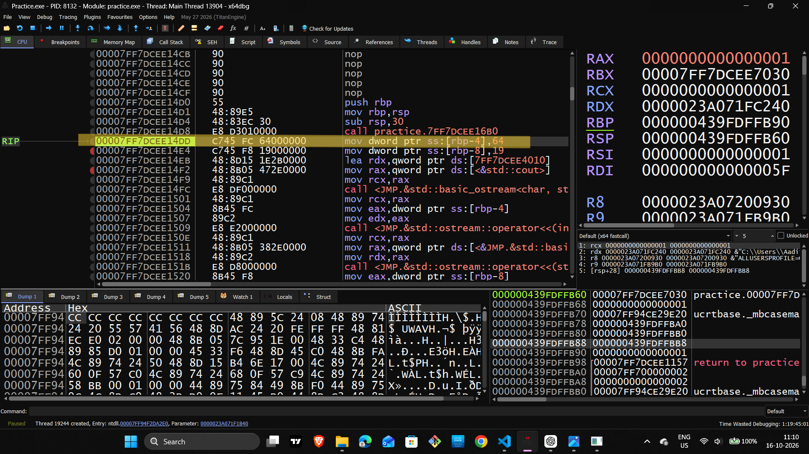
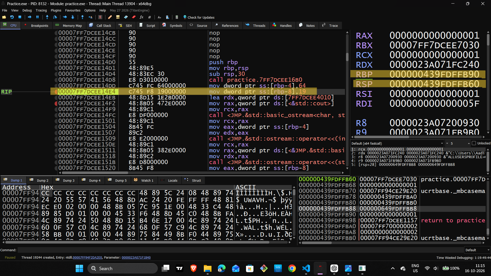
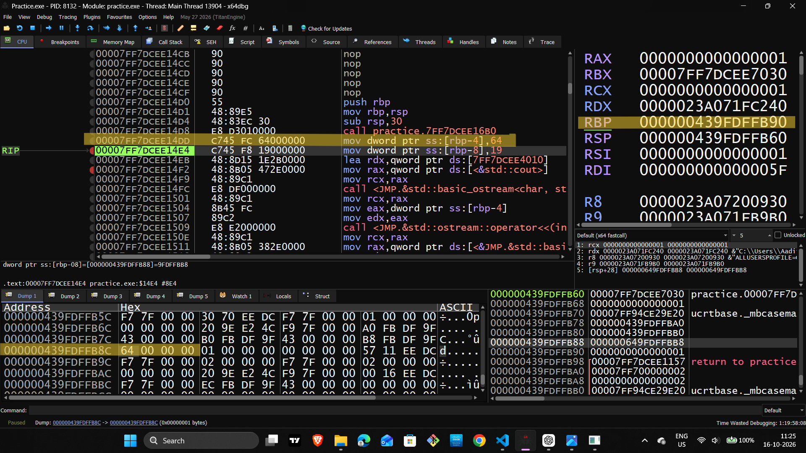
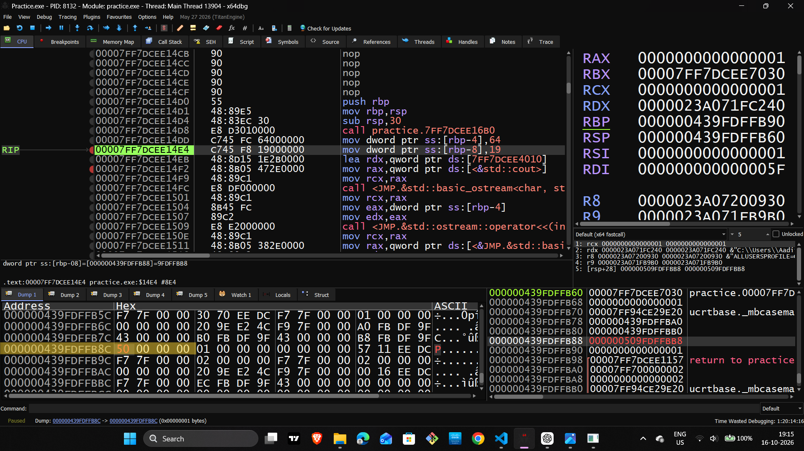
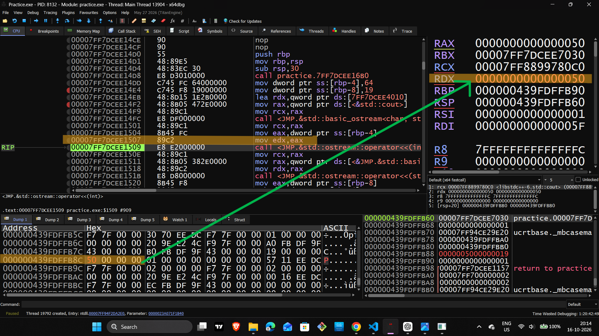
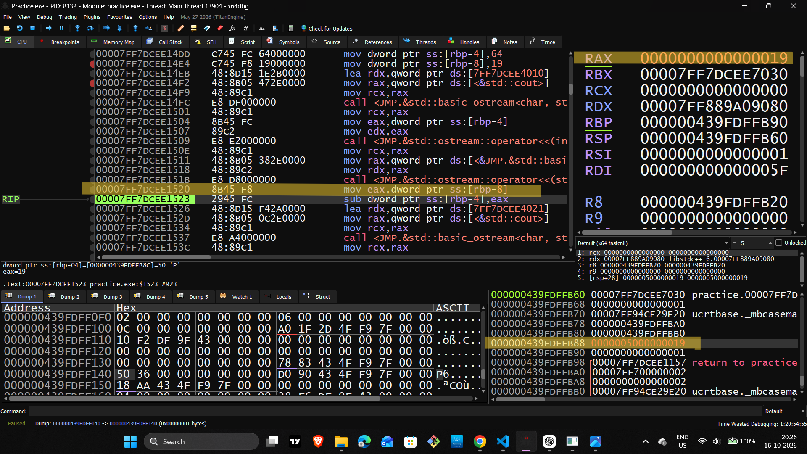
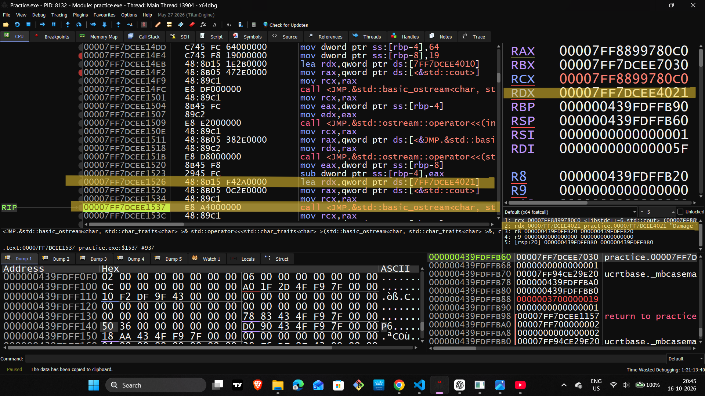

# Day 13 — Memory Access & Data Modification in x64dbg

## 1. Source Code and Practical Setup



We created a simple C++ program containing two variables:

```
int health = 100;
int damage = 25;
```

The program subtracts `damage` from `health` and then adds 10 during recovery.

Why did we do this?

We needed a small, predictable program for our first memory-modification experiment. If we had used a large application, it would have been harder to identify which memory locations belonged to the values we wanted to inspect.

The `health` and `damage` variables gave us two distinct values to follow through the debugger. This made it easier to compare the original source code, the compiled assembly instructions, the register values, and the memory dump.

## 2. Compile and Run the Program



We compiled the source code and checked the program's normal output before debugging it.

Why did we do this?

We needed to confirm that the program compiled successfully and that its original calculation behaved as expected. This gave us a baseline for comparison.

Without this step, we would not have a reliable reference for deciding whether a value observed later was original, modified, or produced by a calculation.

## 3. Open `Practice.exe` in x64dbg



We opened our compiled executable in x64dbg and inspected the CPU view.

Why did we do this?

The source code shows what we wrote, but the debugger allows us to observe the instructions and runtime state of the compiled program.

We used the CPU view to follow execution, the register panel to inspect values held by CPU registers, and the dump panel to examine bytes stored in memory. These views helped us connect the source-level variables to the program's actual execution.

## 4. Locate the Health Variable



We inspected the instruction:

```
mov dword ptr ss:[rbp-4], 64
```

The immediate value `64` is hexadecimal for decimal `100`.

Why did we do this?

We wanted to identify how the initial health value was represented in assembly and where the compiled program stored it.

The instruction showed a write to the stack-relative location `[RBP-4]`. In our program's current build, we used this location to track `health`. This gave us a specific address to inspect rather than searching through memory without knowing what to look for.

## 5. Locate the Damage Variable



We inspected:

```
mov dword ptr ss:[rbp-8], 19
```

The hexadecimal value `19` represents decimal `25`.

Why did we do this?

We needed to locate the second variable independently. Identifying both values helped us understand which memory location held health and which held damage.

This distinction became important when we modified health and later observed the subtraction. We could compare the two values without accidentally treating one as the other.

## 6. Inspect Health Before Modification



We inspected the memory at the address calculated as `RBP-4`. The bytes were:

```
64 00 00 00
```

These bytes represent the 32-bit integer `100` on our little-endian system.

Why did we do this?

We needed to establish the exact value stored in memory before making a change. This was our reference state.

Recording the original bytes also helped us verify that the later modification was real. Instead of assuming that the debugger had selected the correct variable, we compared the memory before and after editing it.

## 7. Modify the Health Value



We changed the bytes at the health variable's memory location from:

```
64 00 00 00
```

to:

```
50 00 00 00
```

The new integer value was `80`.

Why did we do this?

The purpose was to test whether changing a variable in the running process would affect a later calculation.

We did not change the original C++ source code. We changed the value held in the current process's memory. This allowed us to observe the difference between a variable's initial value in the source program and its value during execution.

This is a useful debugging and reverse-engineering technique because runtime values can influence branches, calculations, and program behavior.

## 8. Read the Modified Health into a Register



We executed:

```
mov eax, dword ptr ss:[rbp-4]
```

The register showed `0x50`, which represents decimal `80`.

Why did we do this?

Changing memory was only part of the experiment. We also wanted to verify that the program could read the modified value.

The instruction copied the 32-bit value from the health memory location into `EAX`. Seeing `0x50` in the register confirmed that the modified value was available to the executing instructions.

This connected our memory edit to the value being processed by the CPU.

## 9. Read the Damage into a Register



We inspected:

```
mov eax, dword ptr ss:[rbp-8]
```

The register showed `0x19`, which represents decimal `25`.

Why did we do this?

We needed to verify the damage value separately from the modified health value.

This helped us understand the operands used by the subtraction. It also demonstrated that registers are reused: `EAX` can contain health at one point and damage at another, depending on the instruction currently executing.

## 10. Observe the Output Instructions



We followed instructions associated with preparing the damage value for console output, including:

```
mov edx, eax
```

Why did we do this?

We wanted to understand what the program was doing at that point in execution and distinguish output-related operations from the health calculation.

A value appearing in a register does not automatically mean it is being used for subtraction. Following the instructions helped us understand the program's execution order and avoid confusing a value being prepared for printing with a value being used in an arithmetic operation.

## 11. Verify the Result in Memory

During the practical, the memory dump showed the adjacent values together:

```
0000003700000019
```

The four bytes at the damage location represented `25`, while the four bytes at the health location represented `55`.

The calculation was:

\\[ 80 - 25 = 55 \\]

Why did we do this?

We wanted to verify the result actually stored by the program rather than relying only on our manual calculation.

The value `0x37` at the health location corresponds to decimal `55`. This matched the expected result of subtracting damage from the modified health value.

This was the most important observation in the practical: the program used the modified runtime value, and the resulting health value was visible in memory.

## 12. Practical Conclusion

In this practical, we used x64dbg to locate two variables, inspect their memory contents, modify the health value, read values into CPU registers, and verify the result of a calculation.

The key observation was:

```
Original health: 100
Modified health:  80
Damage:           25
Result:            55
```

This experiment demonstrated how runtime memory affects a program's calculations and how a debugger can be used to verify those changes.

Note: The final console output was not verified after our last debugging session, so this README documents the memory observations we actually made rather than claiming an unverified final-output screenshot.